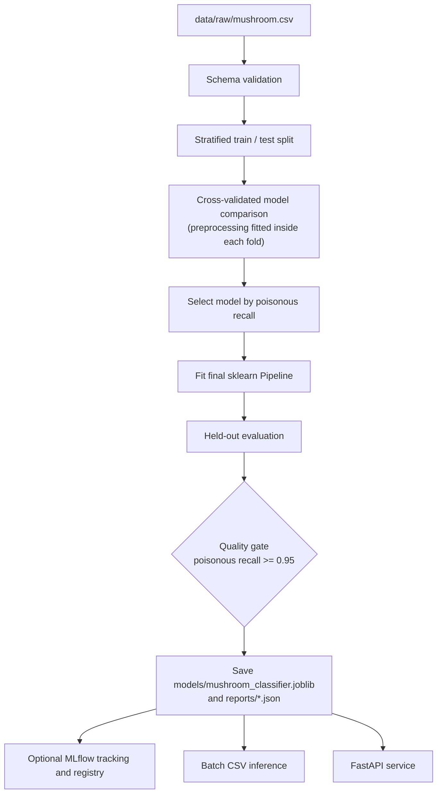

# Mushroom Classification

[](https://www.python.org/)
[](https://scikit-learn.org/)
[](https://mlflow.org/)
[](https://fastapi.tiangolo.com/)
[](https://www.docker.com/)

A reproducible binary-classification pipeline for the UCI mushroom dataset. It validates categorical data, compares models with stratified cross-validation, fits preprocessing only on training folds, evaluates on a held-out test split, and optionally tracks and registers the selected model with MLflow. The trained pipeline can be used for batch CSV inference or served through a small FastAPI application.

> [!WARNING]
> **Educational and research use only.** Predictions from this project must never be used to decide whether a real mushroom is safe to eat. Misidentifying a poisonous mushroom can be fatal. This repository is an academic demonstration of ML engineering practice, not a food-safety system.

## Table of Contents

- [Project Overview](#project-overview)
- [Key Features](#key-features)
- [Machine Learning Workflow](#machine-learning-workflow)
- [Dataset](#dataset)
- [Technology Stack](#technology-stack)
- [Project Structure](#project-structure)
- [Installation and Setup](#installation-and-setup)
- [Running the Project](#running-the-project)
- [Model Development and Evaluation](#model-development-and-evaluation)
- [Experiment Tracking](#experiment-tracking)
- [Generated Artifacts](#generated-artifacts)
- [API and Docker](#api-and-docker)
- [Testing and CI](#testing-and-ci)
- [Limitations and Future Improvements](#limitations-and-future-improvements)
- [Safety Disclaimer](#safety-disclaimer)
- [License and Author](#license-and-author)

## Project Overview

Mushroom identification is a textbook example of a classification problem where the cost of errors is asymmetric: calling a poisonous mushroom edible is far worse than the reverse. This project uses that property to frame the engineering around **recall on the poisonous class** rather than overall accuracy.

The pipeline covers the full path from raw CSV to a persisted, versioned model:

1. Validate the schema and report data-quality issues.
2. Split the data with stratification and compare candidate models using training-only cross-validation.
3. Select the model by poisonous-class recall and fit a single scikit-learn `Pipeline` that contains both preprocessing and the estimator.
4. Evaluate on the held-out split and apply a recall-based quality gate.
5. Persist the pipeline and reports, optionally log and register the model in MLflow, and serve predictions in batch or over HTTP.

## Key Features

| Capability | What the project does |
| --- | --- |
| Data validation | Schema validation on the categorical dataset; reports the `?` sentinel used for unknown `stalk-root` values |
| Leakage-safe preprocessing | Preprocessing is part of the sklearn `Pipeline` and is fitted only on training folds |
| Missing and unseen values | Missing values are imputed; previously unseen categories are ignored at inference time |
| Model comparison | Logistic Regression, Decision Tree, Random Forest and K-Nearest Neighbors compared with stratified cross-validation |
| Safety-oriented selection | Models are selected by poisonous recall; a configurable quality gate defaults to recall ≥ 0.95 |
| Evaluation | Accuracy, macro precision/recall/F1, class-specific metrics, ROC-AUC and a correctly ordered confusion matrix |
| Model persistence | The full pipeline is saved with joblib; an inferior candidate does not replace an existing model, and replacements are timestamp-backed-up |
| Experiment tracking | Optional MLflow tracking and model registry, controlled from `config.yaml` |
| Serving | Batch CSV inference, a FastAPI app with health, readiness and prediction endpoints, and a Docker Compose setup |
| Monitoring | Prediction-distribution and latency logging, plus drift diagnostics under `data/monitoring/drift/` |

## Machine Learning Workflow



## Dataset

The project uses the UCI mushroom dataset, supplied as `data/raw/mushroom.csv`.

| Property | Value |
| --- | --- |
| Records | 8,124 |
| Features | 22 categorical features |
| Target column | `class` |
| Labels | `e` (edible), `p` (poisonous) |
| Training target encoding | poisonous = 1 (positive class), edible = 0 |
| Missing values | `stalk-root` uses `?` for unknown; reported by validation and imputed in the fitted pipeline |
| Unseen categories | Ignored at inference |

Feature names are hyphenated (for example `stalk-root`) and the same names are expected by the batch inference command and the API.

## Technology Stack

Dependencies are those listed in `requirements.txt`.

| Library | Role in the project |
| --- | --- |
| Python 3.12 | Verified runtime |
| pandas, NumPy | Data loading and array handling |
| scikit-learn | Preprocessing, models, cross-validation, metrics, `Pipeline` |
| joblib | Model persistence |
| MLflow | Experiment tracking and model registry |
| PyYAML | Configuration (`config.yaml`) |
| matplotlib, seaborn | Plotting |
| Jupyter | Notebook environment |
| FastAPI, uvicorn, httpx | Inference API, ASGI server, HTTP client |
| Docker, GitHub Actions | Local container deployment and CI |

## Project Structure

```text
.
├── api/                          # FastAPI app, schemas, model loading, preprocessing, monitoring
├── artifacts/                    # Existing MLflow databases and history (preserved)
├── data/
│   ├── raw/mushroom.csv          # Original dataset
│   ├── processed/                # Generated splits and metadata
│   └── monitoring/drift/         # Generated drift experiments
├── deployment/                   # Deployment Dockerfile and gate-checked kubectl apply script
├── docs/                         # Architecture and retained lab documentation
├── k8s/                          # Kubernetes deployment and service manifests
├── models/                       # Saved models, including mushroom_classifier.joblib
├── notebooks/
│   └── mushroom_classification.ipynb
├── outputs/                      # Experiment reports and inference outputs
├── pipelines/
│   └── run_mushroom_pipeline.py
├── reports/                      # Generated validation and evaluation reports
├── src/
│   ├── mlops_pipeline/           # Numbered stage entry points and monitoring commands
│   └── mushroom_classification/
│       ├── config.py             # Configuration loading
│       ├── logging_config.py
│       ├── validation.py         # Schema and data-quality checks
│       ├── models.py             # Candidate models
│       ├── pipeline.py           # Preprocessing + estimator pipeline, training flow
│       ├── evaluation.py         # Metrics, confusion matrix, quality gate
│       ├── inference.py          # Batch prediction
│       └── monitoring.py
├── tests/
│   ├── test_mushroom_classification.py
│   ├── test_api.py
│   └── test_monitoring.py
├── .github/workflows/            # CI: unit tests, failure tests, staged runner, monitoring
├── Dockerfile                    # Python 3.12 API image
├── docker-compose.yml            # Local API deployment
├── requirements.txt
└── requirements-api.txt          # Minimal API container dependencies
```

Some historical assets (an earlier churn notebook and unrelated root-level wrappers) are retained as inactive history. The numbered scripts in `src/mlops_pipeline/` have been rewritten as mushroom stage entry points that reuse the `mushroom_classification` package, which is the canonical implementation.

## Installation and Setup

Python 3.12 is the verified version.

```bash
git clone https://github.com/Mokshagnna/mushroom_classification.git
cd mushroom_classification
python -m venv .venv
```

Activate the environment:

```powershell
# Windows PowerShell
.venv\Scripts\Activate.ps1
```

```bash
# Linux / macOS
source .venv/bin/activate
```

Install dependencies:

```bash
python -m pip install -r requirements.txt
```

## Running the Project

Run all commands from the project root.

### 1. Train, evaluate and save the model

```bash
python -m src.mushroom_classification train
```

This validates the dataset, performs the stratified split, compares the four candidate models, evaluates the selected pipeline on the held-out split, and writes the model and JSON reports (see [Generated Artifacts](#generated-artifacts)). MLflow registration runs as part of this command when enabled in `config.yaml`.

To train without MLflow side effects, set `mlflow.enabled: false` in `config.yaml`.

### 2. Batch inference

The input CSV needs all 22 feature columns; the `class` column may be omitted.

```bash
python -m src.mushroom_classification predict --input data/raw/mushroom.csv --output outputs/inference_predictions.csv
```

The output contains predicted class labels and edible/poisonous probabilities.

### 3. Integrated stage runner

```bash
uv run --python 3.12 --with-requirements requirements.txt python -m src.mlops_pipeline.mushroom_classification_pipeline
```

Stage 12 commands provide feature and prediction drift diagnostics and labelled performance evaluation. See the runbook and end-to-end guide under `docs/`.

### 4. Notebook

```bash
jupyter notebook notebooks/mushroom_classification.ipynb
```

### 5. MLflow UI

```bash
mlflow ui
```

Point the UI at the tracking store your configuration uses (for example with `--backend-store-uri`); existing MLflow history is kept under `artifacts/`. A remote server can be selected for training with the `MLFLOW_TRACKING_URI` environment variable.

## Model Development and Evaluation

**Candidate models:** Logistic Regression, Decision Tree, Random Forest, K-Nearest Neighbors.

**Methodology**

- **Stratified holdout split** keeps the class ratio in both train and test sets. The split is deterministic, so candidates can be compared on the same held-out data.
- **Cross-validation uses training data only.** Preprocessing (imputation and categorical encoding) lives inside the `Pipeline`, so it is refit within each fold and nothing from the validation fold leaks into fitting.
- **Selection criterion is poisonous recall**, not accuracy.
- **Quality gate:** the default requires poisonous recall ≥ 0.95 on the held-out set. This is a demonstration threshold, not a safety certification.
- **Replacement policy:** if a model artifact already exists, the new candidate is compared on the same held-out split; an inferior candidate is not installed, and a replacement is timestamp-backed-up.

**Metrics reported:** accuracy, macro precision/recall/F1, class-specific metrics, ROC-AUC, confusion matrix, and the quality-gate result.

**Reading the confusion matrix.** The pipeline encodes poisonous as the positive class (1), so the matrix is ordered edible then poisonous:

| | Predicted edible (0) | Predicted poisonous (1) |
| --- | --- | --- |
| **Actually edible (0)** | True negative | False positive: safe mushroom flagged as poisonous |
| **Actually poisonous (1)** | **False negative: poisonous mushroom predicted edible** | True positive |

With poisonous as the positive class, the dangerous error is the **false negative**, which is why recall on class 1 drives model selection and the quality gate. False positives cost usability (discarding safe mushrooms) but are not the hazardous failure mode.

**Results.** Metric values are written to `reports/` on each run and are not hard-coded here. Run the training command to reproduce them.

> Earlier notebook summaries used an edible-positive mapping while labelling the confusion matrix in the opposite order. The reports generated by the current pipeline use poisonous = 1 and are the authoritative results.

## Experiment Tracking

MLflow is integrated into the training workflow and is enabled in `config.yaml`.

| Setting | How to control it |
| --- | --- |
| Enable or disable tracking and registry | `mlflow.enabled` in `config.yaml` |
| Remote tracking server | `MLFLOW_TRACKING_URI` environment variable |
| Credentials | Never store them in the config file |

The selected model is tracked and registered when MLflow is enabled. Previous MLflow databases and run history are preserved under `artifacts/`.

## Generated Artifacts

| Path | Produced by | Purpose |
| --- | --- | --- |
| `models/mushroom_classifier.joblib` | `train` | Full preprocessing and model pipeline |
| `models/` (timestamped backups) | `train` | Backup of a replaced model |
| `reports/` | `train` | Validation and evaluation JSON |
| `data/processed/` | `train` | Generated splits and metadata |
| `outputs/inference_predictions.csv` | `predict` | Batch predictions with probabilities |
| `logs/inference/mushroom_predictions.jsonl` | API | Append-only prediction log (operational summaries, no feature values) |
| `data/monitoring/drift/` | Stage 12 generators | Synthetic drift experiments; labels are synthetic and never used as ground truth |

Generated model files, reports, MLflow data and processed data remain local or CI artifacts according to `.gitignore`.

## API and Docker

The FastAPI app loads `models/mushroom_classifier.joblib` at startup and uses the same normalization and preprocessing path as batch inference. Requests use the dataset's 22 hyphenated feature names and categorical values; `class` is not accepted.

```bash
uvicorn api.main:app --host 127.0.0.1 --port 8000
```

| Endpoint | Method |
| --- | --- |
| `/health` | GET |
| `/ready` | GET |
| `/metadata` | GET |
| `/predict` | POST |
| `/predict/batch` | POST |

Responses use `0 = edible`, `1 = poisonous` along with class probabilities. Monitoring reports prediction distribution and latency, not accuracy, because no ground-truth labels exist at inference time.

With Docker Compose:

```bash
docker compose up --build
```

The container uses Python 3.12 and `requirements-api.txt`, exposes port 8000, mounts the model directory read-only, and persists monitoring events under `logs/`. The API and container setup are demonstrations only.

## Testing and CI

```bash
python -m unittest discover -s tests -v
```

GitHub Actions runs the unit tests and the training and evaluation workflow when code, configuration, dependencies or the dataset change.

## Limitations and Future Improvements

**Current limitations**

- A single, well-known tabular dataset with categorical descriptors only; it does not reflect real-world field identification, where visual and habitat variability dominate.
- The 0.95 recall gate is a project threshold, not a validated safety standard.
- Inference monitoring cannot measure accuracy without labelled feedback.
- Some historical notebook outputs use a different class mapping from the current pipeline.

**Possible improvements (not implemented)**

- Calibrated probabilities and threshold selection that explicitly targets poisonous recall.
- Broader or external validation data to test generalization.
- Consolidating or retiring legacy notebooks and wrappers.

## Safety Disclaimer

This project is intended for **educational and research purposes only**. Predictions from this model must never be used to determine whether a real mushroom is safe to consume.

## License and Author

No license file is present in the repository, so no license is granted by default. Add one before encouraging reuse.

Author: [Mokshagnna](https://github.com/Mokshagnna)
